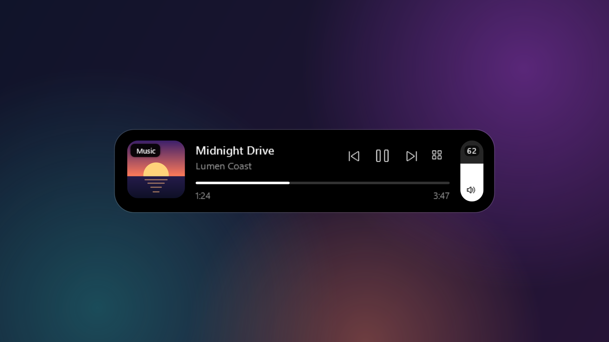
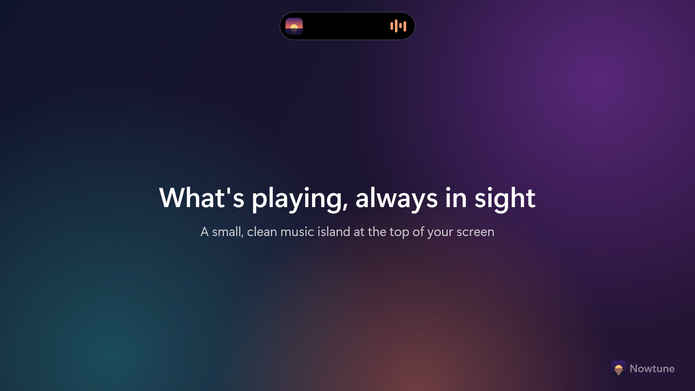
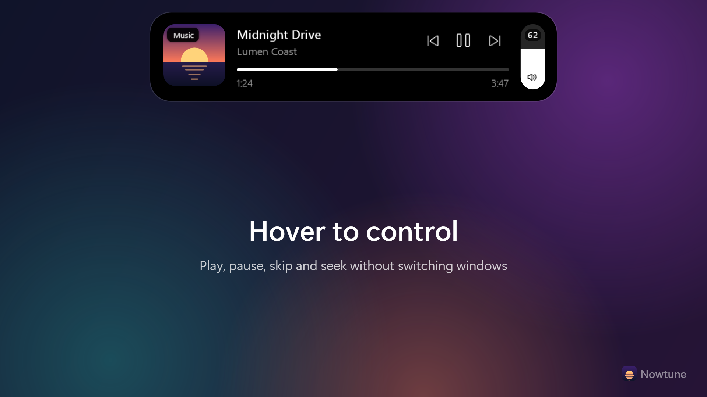
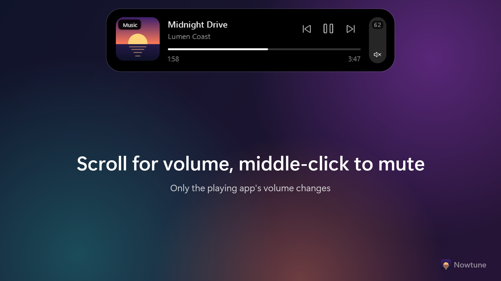
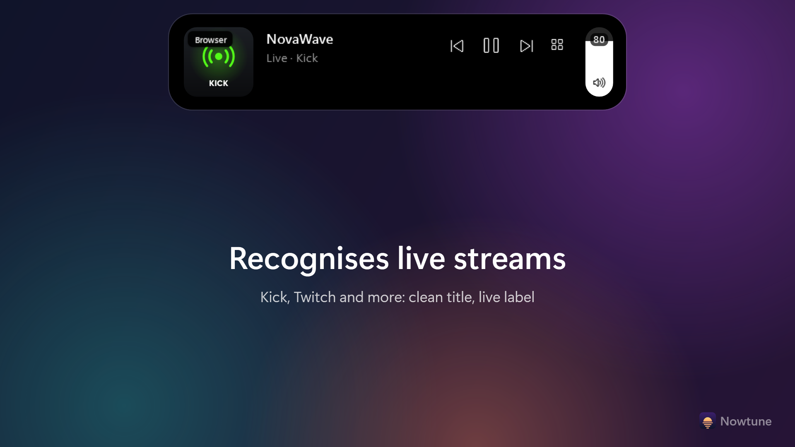
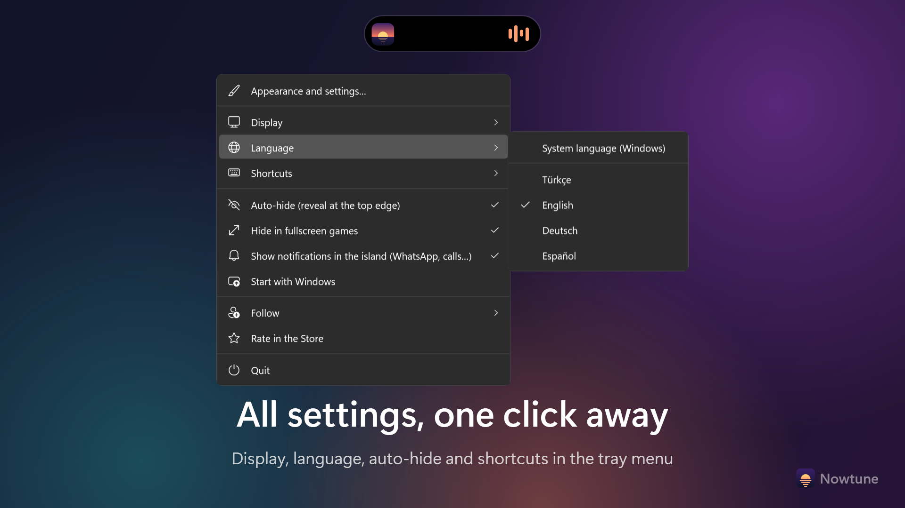
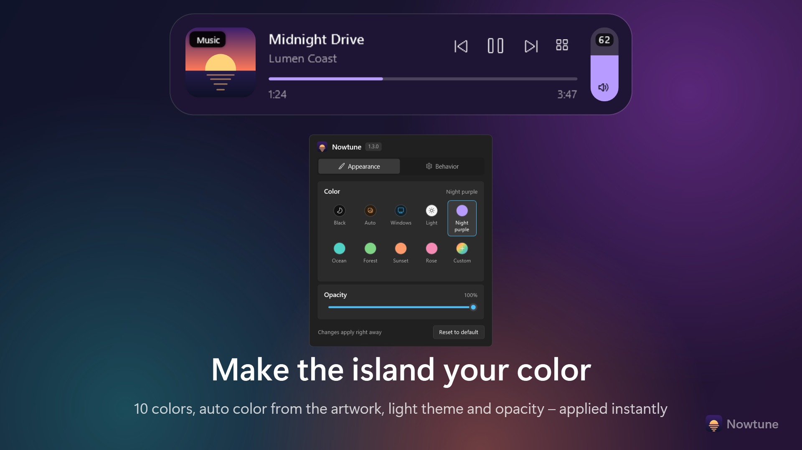

  

<h1 align="center">Nowtune</h1>

<b>A small now-playing music widget for Windows.</b> 
It sits at the top centre of your screen, shows what's playing, and opens into a player when you hover.

  

Free · No ads · No account · No data collection · Works offline

---

## What it does

- **See what's playing** – title, artist and cover art from any app that uses Windows media controls (music apps, browsers, video players).
- **Hover to control** – play / pause, previous / next and a draggable progress bar.
- **Per-app volume** – scroll over the island to change the volume of the app that is playing; middle-click to mute.
- **Stays out of your games** – hides automatically in fullscreen games and videos.
- **Live streams** – browser live streams are recognised and their titles cleaned up.
- **Your colors** – 10 themes, including an auto color that follows each song's cover, plus opacity.
- **Notifications and calls (optional)** – WhatsApp messages and other notifications appear briefly in the island; accept or decline WhatsApp calls right from it. Off by default.
- **No cover? A spinning record** with the playing app's icon on its label.
- Multi-monitor, start with Windows, English / Turkish / German / Spanish.

## Screenshots

| | |
|---|---|
|  |  |
|  |  |
|  |  |

## Get it

Nowtune is free on the **[Microsoft Store](https://apps.microsoft.com/detail/9pbt2hpsczwx)** (Windows 10 2004 or later, x64).
All settings are in the Nowtune icon in the system tray.

## Ideas and bug reports

Found a bug or have an idea? **[Open an issue](../../issues/new)** – every suggestion is read.
If you like Nowtune, a rating on the Microsoft Store helps a lot.

## Privacy

Nowtune does not connect to the internet and does not collect, store or send any data.
Read the full [privacy policy](https://sites.google.com/view/lavuk-studio).

---

### Türkçe

**Nowtune**, Windows için ekranın üst ortasında duran küçük bir müzik widget'ıdır. Çalan şarkıyı gösterir, üzerine gelince oynatma ve uygulama sesi kontrolü açılır, oyunlarda kendini gizler. Ücretsizdir, reklam ve veri toplama yoktur.
[Microsoft Store'dan indir](https://apps.microsoft.com/detail/9pbt2hpsczwx) · Öneri ve hata bildirimi için [issue aç](../../issues/new).

© 2026 Lavuk Studio · Contact: lavukstudio@gmail.com
